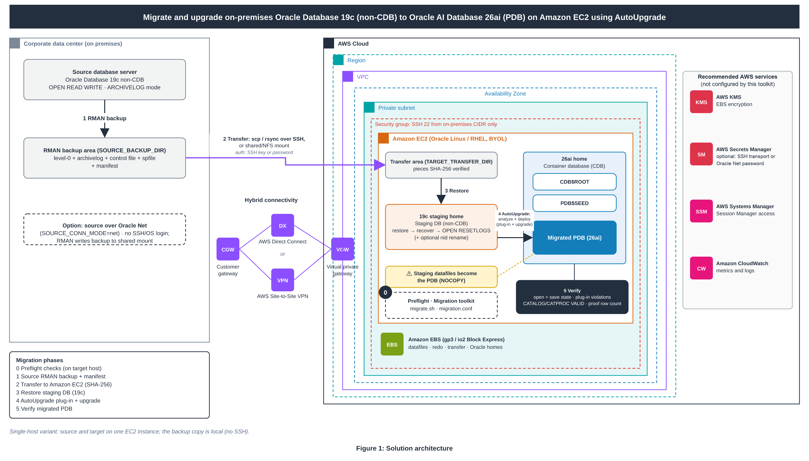

# Oracle 19c non‑CDB → 26ai PDB Migration Toolkit

> **⚠️ Important — sample code.** This toolkit is sample code for learning and
> testing. It is **not** intended for production use as-is. It runs with
> SYSDBA/SYSBACKUP privileges and can `DROP PLUGGABLE DATABASE ... INCLUDING
> DATAFILES` and `shutdown abort`. Test it against **non-production** copies of
> your databases, review the scripts, and apply your organisation's security,
> backup and change controls before running it against a production database.
> See [SECURITY.md](SECURITY.md).

A host‑native **bash** toolkit that migrates a running Oracle **19c non‑CDB**
database into a **pluggable database (PDB)** inside an existing **26ai**
container database (CDB). It does this with a classic, well‑understood path:
take an **RMAN** backup of the source, restore it into a temporary ("staging")
19c instance on the target, then hand that staging instance to Oracle
**AutoUpgrade** in *plug‑in* mode, which upgrades it to 26ai and plugs it into
the CDB as a PDB.

Everything site‑specific — hostnames, paths, SIDs, names, memory, how files are
copied — comes from **one config file**. Nothing is hardcoded, and passwords
never live in that config.

> **New to Oracle terminology?** Read the [Glossary](#0-glossary-plain-english)
> first. This README assumes **no prior knowledge** and explains each term the
> first time it matters.

---

## Table of contents

0. [Glossary (plain English)](#0-glossary-plain-english)
1. [What this toolkit does, in one picture](#1-what-this-toolkit-does-in-one-picture)
2. [The three ways you can run it (topologies)](#2-the-three-ways-you-can-run-it-topologies)
3. [Prerequisites — what must exist before you start](#3-prerequisites--what-must-exist-before-you-start)
4. [Folder layout](#4-folder-layout)
5. [Quick start](#5-quick-start)
6. [Configuration reference — every key explained](#6-configuration-reference--every-key-explained)
7. [Secrets file](#7-secrets-file)
8. [How files get from source to target (transport, in depth)](#8-how-files-get-from-source-to-target-transport-in-depth)
9. [Running the toolkit — commands, flags, resuming](#9-running-the-toolkit--commands-flags-resuming)
10. [The six phases, step by step](#10-the-six-phases-step-by-step)
11. [Tearing down the staging instance (and the NOCOPY rule)](#11-tearing-down-the-staging-instance-and-the-nocopy-rule)
12. [Every file in the toolkit](#12-every-file-in-the-toolkit)
13. [Exit codes](#13-exit-codes)
14. [Use‑case playbook (copy‑paste scenarios)](#14-use-case-playbook-copy-paste-scenarios)
15. [Known‑good runbook (a full run that succeeded)](#15-known-good-runbook-a-full-run-that-succeeded)
16. [Troubleshooting — every error we have seen](#16-troubleshooting--every-error-we-have-seen)
17. [Rolling back each phase](#17-rolling-back-each-phase)
18. [Static checks (developers)](#18-static-checks-developers)
19. [Security notes](#19-security-notes)

---

## 0. Glossary (plain English)

| Term | What it means here |
|------|--------------------|
| **non‑CDB** | An old‑style single Oracle database (19c). It is *not* a container, so it cannot hold PDBs. This is the **source** we migrate **from**. |
| **CDB** (Container Database) | A "landlord" database (26ai) that hosts one or more PDBs. This is the **target** we migrate **into**. Its name is `TARGET_CDB_SID`. |
| **PDB** (Pluggable Database) | A "tenant" database living inside a CDB. The migration turns your 19c non‑CDB into one of these. Its name is `TARGET_PDB_NAME`. |
| **Staging instance** | A short‑lived, throwaway 19c database the toolkit builds on the target from the RMAN backup. AutoUpgrade consumes it and turns it into the PDB. Its name is `TARGET_STAGING_SID`. |
| **RMAN** | Oracle's Recovery Manager — the standard backup/restore tool. We take a *compressed level‑0* (full) backup plus archive logs. |
| **AutoUpgrade** | Oracle's official upgrade automation (a `.jar` you run with `java`). In *plug‑in* mode it upgrades the staging 19c DB and plugs it into the CDB as a PDB. |
| **ORACLE_HOME** | The directory where an Oracle software version is installed (its binaries). You have a 19c home and a 26ai home. |
| **ORACLE_BASE** | The top directory for Oracle admin/diagnostic files on a host. |
| **SID** | The system identifier / instance name of a running Oracle instance (e.g. `SRCDB19`). |
| **DBID** | A unique numeric id Oracle assigns to a database. RMAN needs it to restore a controlfile. |
| **Controlfile** | A small binary file that records a database's structure (which datafiles/redo it has). RMAN restores it first. |
| **Datafile** | A file holding actual table/index data. |
| **Redo log** | Files recording every change, used for crash recovery. |
| **Tempfile** | Scratch space for sorts/joins. Not backed up; the toolkit **recreates** tempfiles on the target. |
| **ARCHIVELOG mode** | A database setting where filled redo logs are archived. Required so RMAN can back up `plus archivelog` and recover cleanly. |
| **OPEN READ WRITE** | The normal running state of a database (as opposed to mounted‑only or read‑only). The source must be in this state. |
| **OMF** (Oracle Managed Files) | A mode where Oracle picks datafile names/paths for you under one base directory (`db_create_file_dest`). The restore uses OMF. |
| **nid** (DBNEWID) | An Oracle tool that changes a database's name and DBID. Used only when you migrate under a **different** name. |
| **OS user** | The operating‑system account that owns the Oracle install (usually `oracle`). DB commands must run as this user. |
| **sudo / runuser** | Ways to run a command *as another OS user* non‑interactively. |
| **scp / rsync** | Tools that copy files between hosts over SSH. |
| **SSH key** | A passwordless way to authenticate over SSH. Strongly preferred over passwords. |
| **sshpass** | A small helper that feeds a password to ssh/scp non‑interactively. Only used if you cannot use keys. |
| **manifest** | A plain‑text file (`manifest.env`) the toolkit writes, recording facts captured from the source (DBID, datafile list, backup piece names + checksums, a data "proof" value). |

---

## 1. What this toolkit does, in one picture



*Figure 1: Solution architecture. Phases 0–5 are numbered on the diagram and described in the table below.*

*The supporting AWS services shown (AWS Secrets Manager, AWS KMS, AWS Systems Manager, Amazon
CloudWatch) are recommended for production hardening and are not configured by this toolkit;
see [SECURITY.md](SECURITY.md).*

The same flow, in text:

```
 SOURCE (19c non-CDB, running)                TARGET (has 19c + 26ai homes, and the CDB)
 ┌──────────────────────────┐                 ┌───────────────────────────────────────────┐
 │ 1. capture facts +        │  backup pieces  │ 3. restore into a staging 19c instance      │
 │    RMAN level-0 backup     │ ───────────────▶│    (controlfile→catalog→restore→recover),   │
 │    + archivelog + ctl/spf  │  scp / rsync /  │    relocate redo+temp, OPEN RESETLOGS,       │
 │    + proof value           │  shared mount   │    optional rename (nid)                     │
 └──────────────────────────┘  + manifest.env  │ 4. AutoUpgrade analyze, then deploy          │
                                                │    → upgrades to 26ai and plugs in as a PDB  │
                                                │ 5. verify: registry VALID + data proof match │
                                                └───────────────────────────────────────────┘
```

The work is split into **six phases**. You can run them all at once, or one at a
time, and you can safely re‑run (resume) after fixing a problem.

| # | Phase name | Script | Plain‑English job |
|---|------------|--------|-------------------|
| 0 | `preflight` | `bin/00_preflight.sh` | Check everything *before* touching anything: can we log in, do the homes/binaries exist, is the source OPEN READ WRITE, is there enough free space, can we copy files non‑interactively, do paths not collide. |
| 1 | `source_backup` | `bin/10_source_backup.sh` | Record the source's facts (the manifest) and take the RMAN backup. |
| 2 | `transfer` | `bin/20_transfer.sh` | Copy the backup pieces to the target and checksum‑verify them. |
| 3 | `target_restore` | `bin/30_target_restore.sh` | Rebuild a staging 19c database from the backup, relocate redo/temp, open it, optionally rename it. |
| 4 | `autoupgrade` | `bin/40_autoupgrade.sh` | Run AutoUpgrade to upgrade + plug the staging DB into the CDB as the PDB. |
| 5 | `verify` | `bin/50_verify.sh` | Prove it worked: PDB open, data dictionary VALID, and the row‑count "proof" matches the source. |

**The source is read-only.** The toolkit takes an RMAN backup and does not
change the source database or its persistent RMAN configuration. The only writes
it can make on the source *host* are optional unified-audit `.bin` moves, and
only when `BEHAVIOR_AUDIT_REMEDIATION_SCOPE` includes the source (see
[SECURITY.md](SECURITY.md), "What the toolkit changes"). Its backup never modifies your source
database — it just backs it up. Everything it *creates* lives on the target.

---

## 2. The three ways you can run it (topologies)

The **same code** supports all three. You choose by setting `SOURCE_HOST`,
`TARGET_HOST`, and (for the third case) `FORCE_REMOTE_TRANSPORT`.

### A. Two separate hosts (source and target on different machines)
Source DB on host A, the 19c/26ai homes and the CDB on host B.

- Set `SOURCE_HOST`/`TARGET_HOST` to the two real hostnames or IPs.
- The backup is copied from A to B over **SSH** (`scp` or `rsync`), or placed on
  a **shared mount** both can see.
- You must give the `oracle` user a **non‑interactive** way to copy: an SSH key
  (recommended), or a password via `sshpass`, or the shared mount. See
  [section 8](#8-how-files-get-from-source-to-target-transport-in-depth).

### B. One host (source and target are the same machine)
Common for consolidation or a lab. Set `SOURCE_HOST`/`TARGET_HOST` to
`localhost` (or the machine's own hostname/IP — the toolkit recognizes its own
addresses). The copy degrades automatically to a **local file copy** (`cp`/local
`rsync`) — no SSH needed. The staging SID is forced to differ from the live
source SID so the two instances never clash.

### C. One host, but *rehearse* the over‑the‑wire copy
If you want to test the real `scp` path on a single box (to validate keys,
bandwidth, logging) before a true two‑host run, set `FORCE_REMOTE_TRANSPORT=true`.
That forces `scp`/`rsync` even though both endpoints are this machine (you give
`oracle` an SSH key to itself). **This is a testing lever only** — in a genuine
two‑host run you do *not* set it, because the hosts already differ.

### D. Source reached over Oracle Net (no SSH or OS login to the source)
In many shops you are **not** given SSH or an OS login on the source, only a
database account. Set `SOURCE_CONN_MODE=net` and the toolkit talks to the source
purely over Oracle Net with a full connect string
(`user/password@//host:port/service`), the way any DBA connects from a client.
In this mode:

- The source **manifest** and **proof** are read over Oracle Net with `sqlplus`.
- The RMAN **backup runs as a server session on the source**
  (`rman target "user/pw@//host:port/service as sysbackup"`), so the pieces are
  written by the source instance itself onto a **shared mount** both hosts can
  see. Net mode therefore **requires `TRANSPORT_METHOD=shared`** — there is no
  SSH to copy a backup off the source.
- No OS access to the source is used, so source-side audit-file remediation is
  skipped with a warning.

The default is `SOURCE_CONN_MODE=os` (OS login + `/ as sysdba`, used by
topologies A–C). See [6.1](#61-source_--the-19c-database-you-migrate-from) for
every net key and [section 7](#7-secrets-file) for where the password goes.

### The tool always runs ON the target host (a hard prerequisite)
Whichever topology you pick, **run the toolkit on the target host** — the box
with the staging home, the 26ai home, and the CDB. Building the staging instance
(`startup nomount`), `nid`, and AutoUpgrade are local operating-system operations
and **cannot** be driven over Oracle Net, so the target is always local. Only the
**source** may be remote (over SSH in A/C, or over Oracle Net in D). Preflight
enforces this and fails fast if `TARGET_HOST` does not resolve to this machine.

---

## 3. Prerequisites — what must exist before you start

The toolkit **does not install Oracle software**. Before running:

**On the TARGET host** (this is where you run the toolkit):
- A **19c staging home** (`TARGET_STAGING_HOME`) that provides `bin/rman`,
  `bin/nid`, and `bin/sqlplus`.
- A **26ai home** (`TARGET_26AI_HOME`) that provides the AutoUpgrade jar
  (`rdbms/admin/autoupgrade.jar`) and a JDK (`jdk/bin/java`).
- The destination **CDB** (`TARGET_CDB_SID`) created and open, with at least one
  free **PDB slot** (see the ORA‑65010 note in [Troubleshooting](#16-troubleshooting--every-error-we-have-seen)). Preflight now checks this against `TARGET_PDB_SLOT_LIMIT` (your licensed PDB ceiling) and fails fast if there is no free slot, instead of letting the plug fail ~10 minutes into AutoUpgrade.

**On the SOURCE host:**
- The 19c non‑CDB **running, in ARCHIVELOG mode, and OPEN READ WRITE**. Preflight
  rejects a mounted‑only or read‑only source.
- Free space in `SOURCE_BACKUP_DIR` for a compressed backup + archive logs.

**For a *net* source (`SOURCE_CONN_MODE=net`) — instead of SSH/OS access:**
- The source listener and database must be **up and reachable** at the configured
  `//host:port/service` before you run (preflight probes it; a stopped listener
  shows `ORA-12541`). A dedicated static listener is a clean way to expose the
  source service.
- A migration database account — it need **not** be SYS. Minimum grants:
  `CREATE SESSION`, `SELECT_CATALOG_ROLE` (to read the manifest views), `SELECT`
  on your proof object, and **`SYSBACKUP`** (RMAN must connect `AS SYSBACKUP` /
  `AS SYSDBA` — a plain user cannot drive RMAN). Its password goes in the
  `SECRETS_FILE` as `SOURCE_DB_PASSWORD`.
- `TRANSPORT_METHOD=shared` with a `TRANSPORT_SHARED_PATH` both hosts see — the
  source instance writes the backup there, since there is no SSH to copy it off.

**On every host where the toolkit runs:**
- **Bash ≥ 4.2.** `bin/migrate.sh` asserts this at startup. (macOS ships bash
  3.2, which is fine only for `bash -n` static checks, not for a real run.)
- Standard tools: `rman`, `sqlplus`, `nid` (from the homes), plus `ssh`, `scp`,
  `rsync`, `sha256sum`/`shasum`, `stat`, `awk`, `sed`, `grep`.
- A **non‑interactive way to become the Oracle OS user** — run as `oracle`
  directly, or have passwordless `sudo`/`runuser` to it. Use a *non‑login*
  invocation (`sudo -u oracle bash -c '…'`), not a login shell, to avoid any
  profile menu auto‑launching.

**For two‑host runs only:**
- A **non‑interactive transport**: an SSH key for `oracle` (mode ≤ `0600`), or a
  transfer password (via `sshpass`), or a shared mount. Preflight fails fast if
  none is configured.

### Prerequisite gotcha: glibc relink on a freshly unzipped home
A home that was *unzipped* (rather than installed/relinked by the installer) can
fail to relink with `undefined reference to 'stat' / orion / all_no_orcl`. Fix it
on the affected `$ORACLE_HOME` **before** migrating:

1. `mv "$ORACLE_HOME/lib/stubs/libc.so" "$ORACLE_HOME/lib/stubs/libc.so.bak"`
2. Append `-L/usr/lib64 -lc` to `$ORACLE_HOME/lib/sysliblist`.
3. Re‑run the relink (`relink all`, or the specific failed target).

The toolkit does not perform this step; it only documents it.

---

## 4. Folder layout

```
oracle-26ai-autoupgrade-toolkit/
├── README.md                     ← this file
├── bin/
│   ├── migrate.sh                ← the orchestrator (you run this)
│   ├── 00_preflight.sh           ← phase 0
│   ├── 10_source_backup.sh       ← phase 1
│   ├── 20_transfer.sh            ← phase 2
│   ├── 30_target_restore.sh      ← phase 3 (+ a --teardown helper)
│   ├── 40_autoupgrade.sh         ← phase 4
│   └── 50_verify.sh              ← phase 5
├── lib/
│   ├── common.sh                 ← all shared logic (config, logging, transport, state…)
│   └── version.sh                ← version string + supported‑path matrix (data only)
├── conf/
│   ├── migration.conf.example    ← copy this to make your config
│   └── secrets.env.example       ← copy this only if you need a password
├── templates/
│   ├── staging_init.ora.tmpl     ← staging pfile
│   ├── rman_backup.rman.tmpl     ← source backup script
│   ├── rman_restore.rman.tmpl    ← target restore script
│   ├── autoupgrade.cfg.tmpl      ← AutoUpgrade config
│   └── sql/*.tmpl                ← all the sqlplus steps (capture, checks, relocate, verify…)
└── tools/
    └── static_checks.sh          ← developer sanity gates (no DB needed)
```

Per‑run output (logs, state, rendered scripts, manifest) is written under
`BEHAVIOR_LOG_BASE_DIR` (default `<toolkit>/run`) and is never committed:

```
<LOG_BASE>/<MIGRATION_ID>/
├── state                 ← KEY=value step status (this is what makes resume work)
├── manifest.env          ← facts captured from the source + backup piece list
└── run_<UTC_TS>/
    ├── main.log  debug.log  plan.txt
    └── rendered/         ← every template rendered for this run (sql/ + rman + cfg + pfile)
```

`MIGRATION_ID` is always `<TARGET_CDB_SID>__<TARGET_PDB_NAME>` (e.g.
`CDB26AI__NCDB19CS`). It is how the toolkit keeps separate migrations apart.

---

## 5. Quick start

```bash
# 1. Make your config from the template and edit it.
cp conf/migration.conf.example conf/migration.conf
#   …edit conf/migration.conf for your site (section 6 explains every key)…

# 2. (Optional) only if you need a password (e.g. SSH password transport or an Oracle Net source):
cp conf/secrets.env.example ~/.migration/secrets.env
chmod 600 ~/.migration/secrets.env
#   …put the password in it, then set SECRETS_FILE=/home/you/.migration/secrets.env in the config…

# 3. ALWAYS dry-run first. This validates, prints the plan, and renders every
#    template, WITHOUT touching any database or host.
bin/migrate.sh --dry-run --config conf/migration.conf

# 4. Run for real. With no step flags it resumes from the first step not yet done.
bin/migrate.sh --config conf/migration.conf
```

Run as (or via sudo to) the Oracle OS user, e.g.:

```bash
sudo -u oracle /usr/bin/bash bin/migrate.sh --config conf/migration.conf --yes
```

---

## 6. Configuration reference — every key explained

The config is **parsed line by line and never executed** as shell. Rules:

- Write `KEY=value`. **No spaces** around `=` (`KEY=value`, not `KEY = value`).
- Keys are UPPERCASE. The value is everything after the first `=`.
- One surrounding pair of quotes is stripped.
- Blank lines and lines starting with `#` are ignored.
- Shell expansions (`$VAR`, `$(...)`, backticks) are taken **literally** — do not
  use them.
- An **unknown but well‑formed** key is warned about and ignored. A **missing
  required** key is fatal (exit `2`).

Below, every key is listed with: **meaning**, whether it is **required**, its
**default**, and **when to change it**. The authoritative per‑key comments also
live in [`conf/migration.conf.example`](conf/migration.conf.example).

### 6.1 SOURCE_* — the 19c database you migrate from

| Key | Required? | Default | Meaning / when to set |
|-----|-----------|---------|-----------------------|
| `SOURCE_HOST` | no | `localhost` | Hostname/IP of the source host. `localhost` (or this box's own name/IP) ⇒ single‑host mode. |
| `SOURCE_SSH_USER` | no | `oracle` | SSH login user when the source is remote. |
| `SOURCE_SSH_PORT` | no | `22` | SSH port for the source. |
| `SOURCE_SSH_KEY` | only if source is remote | — | Private key to SSH to the source. Mode must be ≤ `0600`. |
| `SOURCE_OS_USER` | no | `oracle` | OS user that owns the source Oracle install (DB commands run as this user). |
| `SOURCE_ORACLE_BASE` | **yes** | — | `ORACLE_BASE` on the source. |
| `SOURCE_ORACLE_HOME` | **yes** | — | `ORACLE_HOME` of the running 19c instance. |
| `SOURCE_ORACLE_SID` | **yes** | — | SID of the running 19c non‑CDB. Regex `^[A-Za-z][A-Za-z0-9_$]{0,11}$`. |
| `SOURCE_DB_NAME` | no | = `SOURCE_ORACLE_SID` | DB name of the source (used for the restore's `db_name` and as the default final name). |
| `SOURCE_BACKUP_DIR` | **yes** | — | Directory on the source where the RMAN backup is written. Needs free space. |
| `SOURCE_BACKUP_TAG` | no | `MIG_<UTC_TS>` | Backup tag. Left unset it is auto‑generated and stored in the manifest so later phases/resumes reuse the same one. |
| `SOURCE_EXPECTED_VERSION` | no | `19` | Advisory preflight check of the source major version. |
| `SOURCE_EXPECTED_CHARSET` | no | `AL32UTF8` | Advisory preflight check of the character set. |
| `SOURCE_DATAFILE_PATHS` | only as a fallback | — | Space‑separated datafile/redo paths, used **only** for the single‑host overlap check when the source is unreachable at preflight. |
| `SOURCE_CONN_MODE` | no | `os` | `os` = SSH/OS login + `/ as sysdba` (topologies A–C). `net` = reach the source over Oracle Net (topology D); requires `TRANSPORT_METHOD=shared`. |
| `SOURCE_CONNECT_STRING` | net: this or the host/port/service trio | — | Full source connect string, e.g. `//host:port/service` (EZConnect) or a TNS alias. Used by both `sqlplus` and RMAN. |
| `SOURCE_DB_HOST` / `SOURCE_DB_PORT` / `SOURCE_DB_SERVICE` | net: if no `SOURCE_CONNECT_STRING` | port `1521` | Build the descriptor from parts when you did not give `SOURCE_CONNECT_STRING`. |
| `SOURCE_DB_USER` | yes if `net` | — | Migration DB account (need not be SYS). |
| `SOURCE_DB_ROLE` | no | `normal` | sqlplus connect role for the net user: `normal` \| `sysdba` \| `sysbackup`. |
| `SOURCE_RMAN_ROLE` | no | `sysbackup` | RMAN connect role: `sysbackup` \| `sysdba`. Must not be `normal` — RMAN requires SYSBACKUP/SYSDBA. |
| `SOURCE_DB_PASSWORD` | yes if `net` | — | Password for `SOURCE_DB_USER`. **Put it in the `SECRETS_FILE` only**, never in the main config. |

### 6.2 TARGET_* — the host with the homes and the CDB

| Key | Required? | Default | Meaning / when to set |
|-----|-----------|---------|-----------------------|
| `TARGET_HOST` | no | `localhost` | Hostname/IP of the target host. `localhost`/own name/IP ⇒ single‑host. |
| `TARGET_SSH_USER` | no | `oracle` | SSH login user when the target is remote. |
| `TARGET_SSH_PORT` | no | `22` | SSH port for the target. |
| `TARGET_SSH_KEY` | only if target is remote | — | Private key to SSH to the target. Mode ≤ `0600`. Also used by the transfer if `TRANSPORT_SSH_KEY` is unset. |
| `TARGET_OS_USER` | no | `oracle` | OS user that owns the target Oracle install. |
| `TARGET_ORACLE_BASE` | **yes** | — | `ORACLE_BASE` on the target. |
| `TARGET_STAGING_HOME` | **yes** | — | 19c staging `ORACLE_HOME` (must have `bin/rman`, `bin/nid`, `bin/sqlplus`). |
| `TARGET_26AI_HOME` | **yes** | — | 26ai `ORACLE_HOME` (must have the AutoUpgrade jar and a JDK). |
| `TARGET_CDB_SID` | **yes** | — | SID of the destination CDB. Must differ from the source SID and (on one host) from the staging SID. |
| `TARGET_TRANSFER_DIR` | **yes** | — | Directory on the target that receives the shipped backup pieces. |
| `TARGET_DATAFILE_DEST` | **yes** | — | OMF base for the restored datafiles (`db_create_file_dest`). Needs space for the full DB. **Use a distinct directory per migration** (see NOCOPY rule, section 11). |
| `TARGET_REDO_DEST` | no | = `TARGET_DATAFILE_DEST` | Where relocated online redo logs go. |
| `TARGET_STAGING_SID` | no | derived | Staging instance SID. Left unset it is derived to be distinct from the CDB SID (and from the live source SID on one host). |
| `TARGET_STAGING_DB_NAME` | yes if `MATCH_SOURCE_NAME=false` | = `SOURCE_DB_NAME` | The staging DB name. If it differs from `SOURCE_DB_NAME`, a `nid` rename runs. |
| `TARGET_PDB_NAME` | yes if `MATCH_SOURCE_NAME=false` | derived from `SOURCE_DB_NAME` | Name of the PDB created in the CDB. Regex `^[A-Za-z][A-Za-z0-9_$]{0,29}$`. |
| `TARGET_STAGING_MEMORY_MB` | no | `2048` | Memory (MB) for the staging instance. Minimum `800`. Split 75% SGA / 25% PGA internally. |
| `TARGET_EXPECTED_VERSION` | no | `23` | Version prefix the registry must match at verify (26ai reports `23.x`). |
| `TARGET_PDB_SLOT_LIMIT` | no | = `max_pdbs` | Your **licensed** maximum number of user PDBs in the CDB. Preflight fails fast if adding this PDB would exceed it. Set it to your real ceiling — commonly `3` without the Multitenant option (and on Amazon EC2); `max_pdbs` alone can read higher than the enforced cap. |

### 6.3 TRANSPORT_* — how the backup gets to the target

See [section 8](#8-how-files-get-from-source-to-target-transport-in-depth) for the
full decision logic. Keys:

| Key | Required? | Default | Meaning |
|-----|-----------|---------|---------|
| `TRANSPORT_METHOD` | no | `scp` | `scp` \| `rsync` \| `shared`. `shared` = both hosts see one mount; no copy, verify‑only. |
| `TRANSPORT_SSH_KEY` | no | = role SSH key | Private key for the transfer channel specifically. Falls back to `TARGET_SSH_KEY`. |
| `TRANSPORT_SSH_PASSWORD` | no (secrets only) | — | **Fallback** password for `scp`/`rsync` when keys are not possible. **Put it in the `SECRETS_FILE`, never in the main config.** Requires `sshpass`. |
| `TRANSPORT_BANDWIDTH_KBPS` | no | `0` | Bandwidth cap in KB/s (`0` = unlimited; `rsync` honors it via `--bwlimit`). |
| `TRANSPORT_COMPRESS` | no | `true` | Compress on the wire where the method supports it (`-C`/`-z`). |
| `TRANSPORT_SHARED_PATH` | yes if `TRANSPORT_METHOD=shared` | — | Pre‑mounted path both hosts can see. |
| `TRANSPORT_RETRIES` | no | `2` | Transfer retry attempts per transfer. |
| `FORCE_REMOTE_TRANSPORT` | no | `false` | **Testing lever.** Force `scp`/`rsync` even when both hosts resolve to this machine. Never applies to `shared`. |

### 6.4 AUTOUPGRADE_* — the upgrade/plug‑in phase

| Key | Required? | Default | Meaning |
|-----|-----------|---------|---------|
| `AUTOUPGRADE_JAR` | no | `<TARGET_26AI_HOME>/rdbms/admin/autoupgrade.jar` | Path to the AutoUpgrade jar. |
| `AUTOUPGRADE_JAVA` | no | `<TARGET_26AI_HOME>/jdk/bin/java` | Java binary used to run the jar. |
| `AUTOUPGRADE_LOG_DIR` | no | `<TARGET_ORACLE_BASE>/autoupgrade/<MIGRATION_ID>` | Where AutoUpgrade writes logs, the rendered `autoupgrade.cfg`, `deploy.out`, `deploy.pid`. |
| `AUTOUPGRADE_TARGET_PDB_COPY_OPTION` | no | — | A `file_name_convert=('/old','/new')` mapping. Set it to dodge ORA‑65005 datafile‑path clashes. |
| `AUTOUPGRADE_EXTRA_OPTIONS` | no | — | Verbatim extra `upg1.*` lines appended to the config. The **only** place a verified parallelism key may go. |
| `AUTOUPGRADE_START_TIME` | no | `NOW` | `NOW` or an AutoUpgrade‑accepted timestamp. |
| `AUTOUPGRADE_TIMEOUT_MIN` | no | `0` | Deploy watchdog in minutes (`0` = wait indefinitely). |
| `AUTOUPGRADE_DEPLOY_POLL_SEC` | no | `30` | Deploy poll interval in seconds (minimum `5`). |

### 6.5 BEHAVIOR_* and global toggles

| Key | Required? | Default | Meaning |
|-----|-----------|---------|---------|
| `MATCH_SOURCE_NAME` | no | `true` | `true` ⇒ derive `TARGET_PDB_NAME`/`TARGET_STAGING_DB_NAME` from `SOURCE_DB_NAME` (same name). `false` ⇒ you **must** set both, and a `nid` rename runs. |
| `BEHAVIOR_LOG_BASE_DIR` | no | `<toolkit>/run` | Base dir for per‑run logs/state/manifest/rendered output. |
| `BEHAVIOR_AUDIT_REMEDIATION` | no | `true` | Move aside stale unified‑audit `.bin` files that can break AutoUpgrade (see ORA‑00600 note). |
| `BEHAVIOR_AUDIT_BACKUP_DIR` | no | `<TARGET_ORACLE_BASE>/audit_quarantine` | Where quarantined `.bin` files are **moved** (never deleted). |
| `BEHAVIOR_AUDIT_REMEDIATION_SCOPE` | no | `staging` | `staging` \| `both` \| `source` — which host's audit files may be remediated. |
| `BEHAVIOR_PROOF_QUERY` | no | `select count(*) from dual` | A single‑value SQL run on the source (at backup) and inside the PDB (at verify); the results are compared. Empty ⇒ proof skipped with a warning. |
| `BEHAVIOR_PROOF_MATCH` | no | `exact` | `exact` (source == PDB) or `nonzero` (PDB value > 0). |
| `BEHAVIOR_TEARDOWN_STAGING` | no | `manual` | `manual` \| `on_success` \| `never` — when to dispose of the staging instance (see section 11). |
| `BEHAVIOR_BACKUP_SPACE_FACTOR` | no | `1.0` | Safety multiplier for sizing `SOURCE_BACKUP_DIR`. |
| `BEHAVIOR_RESTORE_SPACE_FACTOR` | no | `1.2` | Safety multiplier for sizing the restore destinations. |
| `SECRETS_FILE` | no | — | Path to a `0600` secrets file (section 7). If set, it must exist, be mode `0600`, and be owned by you. |

### 6.6 Values the toolkit derives for you (don't set these)

Printed in the plan, not set by you: `MIGRATION_ID`
(`<TARGET_CDB_SID>__<TARGET_PDB_NAME>`), `staging_on_source_host`, a derived
`TARGET_STAGING_SID` (on one host becomes `<SOURCE_DB_NAME>S`, falling back to
`STG1`..`STG9`, always distinct from the CDB and live source SIDs),
`TARGET_PDB_NAME`/`TARGET_STAGING_DB_NAME` when `MATCH_SOURCE_NAME=true`,
`SOURCE_BACKUP_TAG` (`MIG_<UTC_TS>`), and `SOURCE_BACKUP_RUN_DIR`
(`<SOURCE_BACKUP_DIR>/<SOURCE_BACKUP_TAG>`). The phase scripts also build internal
tokens from the manifest (staging pfile path, control file, adump, SGA/PGA split,
compatible, DBID, redo/temp relocation bodies, the controlfile backup piece
name, AutoUpgrade optional lines). Never put any of these in the config.

---

## 7. Secrets file

Database authentication defaults to **OS authentication** (`/ as sysdba`) and
needs no secret. A secrets file is only for a password:

- the migration user's **`SOURCE_DB_PASSWORD`** when the source is reached over
  Oracle Net (`SOURCE_CONN_MODE=net`), or
- a **`TRANSPORT_SSH_PASSWORD`** when you cannot use SSH keys for the copy.

How to use it:

```bash
cp conf/secrets.env.example ~/.migration/secrets.env
chmod 600 ~/.migration/secrets.env          # the toolkit refuses any other mode
#   edit it, then in migration.conf set:
#   SECRETS_FILE=/home/you/.migration/secrets.env
```

The secrets file is parsed the same safe line‑by‑line way (an `export KEY=value`
prefix is tolerated). **Any** value loaded from it — and the value of any config
key whose name contains `PASSWORD`, `PWD`, or `SECRET` — is registered for
**redaction**: it is masked in every log line and in the plan. The static‑check
gate 8 refuses to let the `*.example` files carry a real secret value.

---

## 8. How files get from source to target (transport, in depth)

This is the part people get wrong, so it is spelled out completely.

### 8.1 Same host vs different host
The toolkit calls a host "local" if it is `localhost`, `127.0.0.1`, `::1`, this
machine's hostname (short or FQDN), **or any IP address bound to this machine**.
If **both** `SOURCE_HOST` and `TARGET_HOST` are local, the backup is copied with
a **local file copy** (`rsync -a` if present, else `cp -pR`) — no SSH, no
password. That is the right, efficient behavior for a genuine single‑host
migration.

### 8.2 The three methods (`TRANSPORT_METHOD`)
- **`scp`** (default): copy over SSH, pushing from the source‑local backup dir to
  `TARGET:TARGET_TRANSFER_DIR`. (The toolkit runs on the source side in the
  two‑host model.)
- **`rsync`**: same idea, resumable, honors `TRANSPORT_BANDWIDTH_KBPS`.
- **`shared`**: no copy at all. Both hosts already see `TRANSPORT_SHARED_PATH`
  (e.g. an NFS mount); the toolkit just verifies the pieces are present. **No SSH
  and no password are needed for `shared`.**

### 8.3 The three authentication modes (for `scp`/`rsync` to a remote host)
Resolved automatically, in this order:
1. **SSH key (recommended):** if `TRANSPORT_SSH_KEY` (or `TARGET_SSH_KEY`) is set,
   it is used with `BatchMode=yes` — SSH never prompts, so an automated run can
   never hang. One‑shot end‑to‑end works.
2. **Password via `sshpass` (fallback):** if no key is set but
   `TRANSPORT_SSH_PASSWORD` is present (in the secrets file) **and** `sshpass` is
   installed, the password is fed via the `SSHPASS` environment variable (never
   on the command line). Weaker posture; works one‑shot.
3. **Neither:** the copy would need an interactive password, which breaks
   automation. **Preflight fails fast** (in seconds) with exactly how to fix it.

### 8.4 Fail‑fast preflight message (when a two‑host copy can't be automated)
> One‑shot end‑to‑end cannot run: copying the backup would require an interactive
> password. Choose ONE: **(a)** configure a passwordless SSH key for the oracle
> user (`TARGET_SSH_KEY` or `TRANSPORT_SSH_KEY`), **(b)** set
> `TRANSPORT_SSH_PASSWORD` in the `0600` `SECRETS_FILE` (requires `sshpass`),
> **(c)** use a shared mount (`TRANSPORT_METHOD=shared` with
> `TRANSPORT_SHARED_PATH`), or **(d)** copy the backup to `TARGET_TRANSFER_DIR`
> manually, then resume with `--from target_restore`.

### 8.5 `FORCE_REMOTE_TRANSPORT` (rehearsing the wire on one box)
Set `FORCE_REMOTE_TRANSPORT=true` to force `scp`/`rsync` even though both hosts
resolve to this machine. Give `oracle` an SSH key to itself first:

```bash
sudo -u oracle bash -c '
  mkdir -p ~/.ssh && chmod 700 ~/.ssh
  [ -f ~/.ssh/id_rsa ] || ssh-keygen -t rsa -b 2048 -N "" -f ~/.ssh/id_rsa
  grep -qF "$(cat ~/.ssh/id_rsa.pub)" ~/.ssh/authorized_keys 2>/dev/null || cat ~/.ssh/id_rsa.pub >> ~/.ssh/authorized_keys
  chmod 600 ~/.ssh/authorized_keys ~/.ssh/id_rsa
  ssh -o BatchMode=yes -o StrictHostKeyChecking=accept-new oracle@<this-ip> true && echo OK'
```

then set `TARGET_SSH_KEY=/home/oracle/.ssh/id_rsa` and
`FORCE_REMOTE_TRANSPORT=true`. **Do not** set this flag in a real two‑host run.

### 8.6 What the transfer logs (observability)
The transfer phase prints, for each run:
- the **exact command** it is about to run, e.g.
  `[transfer] exec: scp -P 22 … -i /home/oracle/.ssh/id_rsa <src>/* oracle@<host>:<dst>/`
  (passwords are never shown — `sshpass -e` reads the password from the
  environment);
- the **actual method chosen** — `local-cp (same host, no SSH)`,
  `scp (over SSH)`, `rsync (over SSH)`, or `shared (verify-only, no copy)` — not
  just the configured method;
- a **destination listing** after the copy: the absolute directory, the host that
  holds it, every file with its byte size, and a `N file(s), M bytes total`
  summary;
- then a `verified <piece>` line per piece (sha256 checked against the manifest).

### 8.7 Transport decision table

| Both hosts local? | `FORCE_REMOTE_TRANSPORT` | `TRANSPORT_METHOD` | Result |
|---|---|---|---|
| yes | false | any (non‑shared) | local `cp`/`rsync`, no SSH |
| yes | true | `scp`/`rsync` | real `scp`/`rsync` over SSH (needs key or password) |
| any | — | `shared` | verify‑only on `TRANSPORT_SHARED_PATH`, no SSH/copy |
| no (different hosts) | — | `scp`/`rsync` + key | `scp`/`rsync`, key auth, one‑shot ✅ |
| no | — | `scp`/`rsync` + `TRANSPORT_SSH_PASSWORD` + sshpass | `scp`/`rsync`, password auth, one‑shot ✅ |
| no | — | `scp`/`rsync`, no key/password | **preflight fails fast** with the (a)/(b)/(c)/(d) message |

---

## 9. Running the toolkit — commands, flags, resuming

### 9.1 The command
```bash
bin/migrate.sh --config <file> [options]
```

### 9.2 Every flag

| Flag | Meaning |
|------|---------|
| `--config <file>` | **Required.** Path to your config. |
| `--from <step>` | Start at `<step>` and run through the last step. |
| `--to <step>` | Run through `<step>` (combine with `--from`). |
| `--only <s1,s2,...>` | Run exactly the listed steps (comma‑separated), always, regardless of saved status. |
| `--dry-run` | Validate + derive config, print the plan, render every template. **No DB/host contact.** |
| `--yes` | Skip interactive confirmation prompts (for unattended runs). |
| `--force` | Authorize dropping a **colliding** target PDB. Still prompts unless `--yes`. |
| `-h`, `--help` | Usage. |

Step names, fixed order:
`preflight source_backup transfer target_restore autoupgrade verify`.

### 9.3 How "resume" works
Each step's status (`PENDING`/`RUNNING`/`DONE`/`FAILED`) is stored in
`<LOG_BASE>/<MIGRATION_ID>/state`. A plain re‑run (no `--from`/`--to`/`--only`)
**resumes from the first step that is not `DONE`** and skips completed steps.
Use `--only`/`--from` to force a step to run again.

### 9.4 The CONFIG_SHA guard (why "resume" sometimes refuses)
When a migration's state is first created, the toolkit stamps it with a
`CONFIG_SHA` — a digest of the migration's **identity and placement**:
`MIGRATION_ID`, source/target SIDs and DB names, staging SID/name,
`MATCH_SOURCE_NAME`, `SOURCE_HOST`, and `TARGET_HOST`. If you later change any of
those under the **same** `MIGRATION_ID` and try to resume, it refuses:

> `CONFIG_SHA mismatch: this migration's state was created with a different
> placement/identity. Refusing to resume. Use a fresh MIGRATION_ID or restore the
> original config.`

This is intentional — it stops you from silently mixing two different setups into
one migration's state. **Changing hosts/identity means a new migration**, so pick
a new `TARGET_PDB_NAME` (which changes `MIGRATION_ID`) or revert the changed keys.
Transport‑only keys (`FORCE_REMOTE_TRANSPORT`, `TARGET_SSH_KEY`) are **not** in the
digest and never trip it.

### 9.5 Staged run (recommended for first‑time/learning)
```bash
bin/migrate.sh --config conf/migration.conf --only preflight
bin/migrate.sh --config conf/migration.conf --only source_backup
bin/migrate.sh --config conf/migration.conf --only transfer
bin/migrate.sh --config conf/migration.conf --only target_restore
bin/migrate.sh --config conf/migration.conf --only autoupgrade
bin/migrate.sh --config conf/migration.conf --only verify
```
Each `bin/NN_<phase>.sh` can also be run directly; it simply re‑execs
`bin/migrate.sh --only <step>` with your flags.

---

## 10. The six phases, step by step

Each phase below lists: what it does, what it prints on success, and its failure
exit code. In `--dry-run`, every phase only renders templates and prints a plan.

### Phase 0 — `preflight` (exit `3` on failure)
1. **Target-host gate**: `TARGET_HOST` must resolve to this machine — the staging
   build, `nid`, and AutoUpgrade are local operations (section 2). Fails fast
   otherwise.
2. Renders the source precheck SQL.
3. **Transport gate** (`_preflight_transport`): confirms a non‑interactive copy
   is possible (shared / same‑host / key / sshpass), else fails fast (section 8.4).
4. **Privilege / connectivity probe**: for an `os` source, that we can run a
   command as the Oracle user on both roles; for a `net` source, an Oracle Net
   connect + privilege probe as `SOURCE_DB_USER` over the connect string.
5. **Homes/binaries**: staging has `rman`+`nid`+`sqlplus`; 26ai has the
   AutoUpgrade jar + java. The source home check is skipped for a `net` source
   (the 19c client in the staging home is used instead).
6. **SSH key permissions** ≤ `0600` for any configured key.
7. **Source precheck**: must be **OPEN READ WRITE** at the expected version.
8. **PDB-slot headroom**: the target CDB must have room for the new PDB within
   `TARGET_PDB_SLOT_LIMIT` (or `max_pdbs`); else fails fast with the ORA‑65010
   guidance instead of failing ~10 min into the plug.
9. **Free space** on `SOURCE_BACKUP_DIR`, `TARGET_TRANSFER_DIR`,
   `TARGET_DATAFILE_DEST` (and `TARGET_REDO_DEST` if different), sized from live
   `v$datafile`/`v$tempfile`/`v$log` totals × the space factors.
10. **Single‑host isolation**: on one host, the target datafile/redo/`dbs` paths
    must not overlap the live source's datafile/redo directories.

### Phase 1 — `source_backup` (exit `5` on failure)
1. Captures the **manifest** from the open source: DBID, charset, db_name, every
   datafile, every redo member+group, every tempfile+size, and compatible/undo/
   block‑size attributes.
2. Captures the **proof scalar** (`BEHAVIOR_PROOF_QUERY`) → `PROOF_SOURCE_VALUE`.
3. If `BEHAVIOR_AUDIT_REMEDIATION=true` and scope includes the source, **moves**
   stale UNIAUD `.bin` files aside.
4. Runs the RMAN **compressed level‑0** backup + `plus archivelog` + controlfile
   + spfile into `SOURCE_BACKUP_RUN_DIR`. It does **not** run a persistent
   `configure controlfile autobackup` on the source; a job-scoped `set controlfile
   autobackup format` keeps any autobackup (if the source has it ON) inside the
   run dir, so the source's RMAN configuration is never changed.
5. Enumerates the produced pieces, computes each piece's **sha256**, and records
   the controlfile-backup piece basename (the explicit `ctl_%U` piece, preferred
   over any autobackup) — all into `manifest.env`.

### Phase 2 — `transfer` (exit `5` on failure)
1. Copies the backup pieces + controlfile backup + `manifest.env` to
   `TARGET_TRANSFER_DIR` using the resolved method/auth (section 8), with the
   observability logging (8.6) and up to `TRANSPORT_RETRIES` attempts.
2. **Verifies** each piece's sha256 on the target against the manifest. Any
   mismatch fails the phase.

### Phase 3 — `target_restore` (exit `6` on failure)
1. Derives staging tokens (pfile path, control file, adump, SGA/PGA from
   `TARGET_STAGING_MEMORY_MB`, compatible/undo/block‑size from the manifest).
2. Renders + installs the staging pfile with `db_name=<SOURCE_DB_NAME>` (this is
   what avoids ORA‑01103) and OMF `db_create_file_dest=<TARGET_DATAFILE_DEST>`.
3. RMAN: `startup nomount` → `restore controlfile` (from the shipped `ctl_%U`
   piece, with an autobackup‑format fallback) → `mount` → `catalog` the transfer dir →
   `restore database` → `switch datafile all` → `recover database`.
4. SQL*Plus: **relocate redo** to unique names, **OPEN RESETLOGS**, **relocate
   tempfiles** (recreated with a unique, PDB‑prefixed name under
   `TARGET_DATAFILE_DEST`).
5. If `TARGET_STAGING_DB_NAME != SOURCE_DB_NAME`: run **`nid`** to rename
   (judged by follow‑up state, since `nid` returns non‑zero even on success),
   update the pfile `db_name`, and open resetlogs again.

### Phase 4 — `autoupgrade` (exit `10`, or `4` on collision)
1. Installs the rendered `autoupgrade.cfg` under the log dir.
2. **Clears stale AutoUpgrade recovery data** so a retry starts clean.
3. **Staging ensure-open + open check**: if a prior failed/aborted deploy left
   the staging instance shut down, it is restarted first (so this does not die on
   `ORA-01034`); then it must be OPEN READ WRITE (else exit `4`).
4. **Collision guard**: if a PDB of the target name already exists, fail (exit
   `4`) unless `--force` (then prompt unless `--yes`, and drop it *including
   datafiles*).
5. **analyze** (`-noconsole </dev/null`). If it hits the UNIAUD
   `ORA-00600[kzafp_read_one_field]`, move the staging `.bin` files aside once and
   re‑analyze once.
6. **deploy** — launched **detached** (`nohup … &`, pid file), monitored by
   polling until the PID exits, tailing `deploy.out` into the logs.
7. **Three‑part success test**: a parseable Final Summary **and** ≥1 job finished
   with 0 failed **and** no fatal banner. A vanished PID with no Final Summary is
   treated as indeterminate (exit `10`).

### Phase 5 — `verify` (exit `5` on failure)
1. **Open PDB read‑write + save state** (an already‑open `ORA-65019` is tolerated).
2. **Plug‑in violations**: fail only on an unresolved **ERROR**; a
   `WARNING`/`PENDING` (e.g. the Traditional Audit mismatch, or `XDB`/service‑name
   notices) is reported as benign.
3. **Registry**: `CATALOG` and `CATPROC` must be **VALID** and their version must
   begin with `TARGET_EXPECTED_VERSION`.
4. **Data proof**: run `BEHAVIOR_PROOF_QUERY` inside the PDB and compare to
   `PROOF_SOURCE_VALUE` (`exact`) or require `> 0` (`nonzero`).
5. If `BEHAVIOR_TEARDOWN_STAGING=on_success`, run the confirmation‑gated staging
   teardown here.

---

## 11. Tearing down the staging instance (and the NOCOPY rule)

### Protect and delete the backup pieces
The RMAN pieces in `SOURCE_BACKUP_DIR/<tag>` and `TARGET_TRANSFER_DIR` (or the
shared mount in `shared`/`net` mode) are a **complete, compressed but
unencrypted copy of your source database**. Anyone who can read those
directories, the share, or a volume snapshot can restore the whole database
elsewhere. Treat them like the database itself.

- Create the backup, transfer and shared directories as the Oracle user with
  mode `0700`: `install -d -m 0700 -o oracle -g oinstall <dir>`.
- Keep them on **encrypted storage** — an encrypted Amazon EBS volume, or an
  encrypted NFS / Amazon EFS share (use encryption in transit where available).
  Restrict any NFS export to the source and target hosts only.
- After `verify` succeeds and you no longer need them for rollback, **delete
  them everywhere**:
  `rm -rf -- "<SOURCE_BACKUP_DIR>/<tag>" "<TARGET_TRANSFER_DIR>"`.
  **Never** delete `TARGET_DATAFILE_DEST` (the NOCOPY rule below).
- If you hold the Oracle Advanced Security Option you can also encrypt the RMAN
  backup. See [SECURITY.md](SECURITY.md).


### ⚠️ The NOCOPY rule — read this before deleting anything
AutoUpgrade plugs the staging non‑CDB into the CDB with **NOCOPY**: the staging
datafiles under `TARGET_DATAFILE_DEST` **become the PDB's own datafiles in place**.
Therefore:

- **After a successful migration, do NOT delete `TARGET_DATAFILE_DEST`** — you
  would destroy the live PDB's storage.
- **Use a distinct `TARGET_DATAFILE_DEST` for every migration.** Reusing a prior
  run's directory risks tempfile/datafile collisions and conflating two PDBs'
  storage.

### The teardown helper
The staging *instance* (its control file, pfile/spfile, adump) is throwaway and
can be disposed of **without** touching the datafiles:

```bash
bin/30_target_restore.sh --teardown --config conf/migration.conf        # prompts first
bin/30_target_restore.sh --teardown --config conf/migration.conf --yes  # unattended
```

It does `shutdown abort` of the staging SID and removes only
`control01_<SID>.ctl`, the pfile, `spfile<SID>.ora`, and the adump dir. It
**explicitly leaves the datafiles** ("…datafiles under `<dest>` left for the
operator to reclaim").

### When teardown runs automatically
`BEHAVIOR_TEARDOWN_STAGING`:
- `manual` (default): never automatic — run the helper yourself when ready.
- `on_success`: the `verify` phase runs the (confirmation‑gated) teardown after
  the proof passes.
- `never`: the toolkit never tears down.

---

## 12. Every file in the toolkit

| File | What it is | Notable entry points / options |
|------|------------|--------------------------------|
| `bin/migrate.sh` | The orchestrator. Parses flags, loads/validates/derives config, builds the run list, dispatches phases. | All flags in [9.2](#92-every-flag). Holds no Oracle logic. |
| `bin/00_preflight.sh` | Phase 0 checks. | Standalone: re‑execs `migrate.sh --only preflight`. |
| `bin/10_source_backup.sh` | Phase 1 manifest + RMAN backup. | Standalone re‑exec. |
| `bin/20_transfer.sh` | Phase 2 copy + verify. | Standalone re‑exec. |
| `bin/30_target_restore.sh` | Phase 3 restore. | Standalone re‑exec **and** the `--teardown --config <f> [--yes]` helper (section 11). |
| `bin/40_autoupgrade.sh` | Phase 4 AutoUpgrade analyze + deploy + judge. | Standalone re‑exec. |
| `bin/50_verify.sh` | Phase 5 verification. | Standalone re‑exec. |
| `lib/common.sh` | All shared machinery: config parse/validate/derive, logging + redaction, `run_on`/`run_sql`/`run_rman`, the allowlist template renderer, transport, step/state framework, free‑space/UNIAUD/nid helpers, `host_is_local`, `compute_config_sha`. | Pure library; sourcing it has no side effects. |
| `lib/version.sh` | `TOOLKIT_VERSION` and the supported source→target matrix (`19 → 26ai/23`). Data only. | Parses on bash 3.2; executes on ≥ 4.2. |
| `conf/migration.conf.example` | Fully commented config template. | Copy → edit. |
| `conf/secrets.env.example` | Secrets template (`SOURCE_DB_PASSWORD` and/or `TRANSPORT_SSH_PASSWORD`). | Copy → `chmod 600` → point `SECRETS_FILE` at it. |
| `templates/staging_init.ora.tmpl` | The staging pfile (memory, control file, adump, compatible, db_name). | Rendered per run. |
| `templates/rman_backup.rman.tmpl` | Source RMAN backup script. | `%F`/`%U` are RMAN literals; only allowlisted `${VAR}` tokens are substituted. |
| `templates/rman_restore.rman.tmpl` | Target RMAN restore script (controlfile→catalog→restore→`switch datafile all`→recover). | — |
| `templates/autoupgrade.cfg.tmpl` | AutoUpgrade config (global log dir + `upg1.*`). | `AUTOUPGRADE_EXTRA_OPTIONS` appended verbatim. |
| `templates/sql/*.tmpl` | Every sqlplus step: `source_precheck`, `source_capture`, `proof_rowcount`, `staging_open_check`, `staging_relocate_redo`, `staging_relocate_temp`, `staging_open_resetlogs`, `staging_nid_verify`, `target_collision_check`, `target_drop_pdb`, `pdb_open_savestate`, `pdb_violations`, `pdb_registry`. | Each ends with an explicit `exit`; most run `whenever sqlerror exit failure`. |
| `tools/static_checks.sh` | Developer gates (no DB). | See [section 18](#18-static-checks-developers). |

---

## 13. Exit codes

| Code | Name | Meaning |
|------|------|---------|
| `0` | `EXIT_OK` | Success. |
| `1` | `EXIT_ERR` | Usage / general / unexpected failure. |
| `2` | `EXIT_CONFIG` | Config or validation error (bad/missing keys, CONFIG_SHA mismatch, secrets‑file problems). |
| `3` | `EXIT_PREFLIGHT` | Preflight failure, including insufficient free space, source not OPEN RW, and the no‑non‑interactive‑transport case. |
| `4` | `EXIT_COLLISION` | Target PDB name collision (resolve with `--force`), or staging not open before AutoUpgrade. |
| `5` | `EXIT_TRANSFER` | Backup / transfer / **verify** failure. |
| `6` | `EXIT_RESTORE` | Restore / recover / open / `nid` failure. |
| `10` | `EXIT_UPGRADE` | AutoUpgrade failure (analyze/deploy/judge). |

---

## 14. Use‑case playbook (copy‑paste scenarios)

In all examples, replace placeholders and run as/through the `oracle` OS user.
Dry‑run first every time.

### 14.1 Single host, same database name
```ini
SOURCE_HOST=localhost
TARGET_HOST=localhost
MATCH_SOURCE_NAME=true        # PDB + staging names derived from SOURCE_DB_NAME
```
```bash
bin/migrate.sh --dry-run --config conf/migration.conf
bin/migrate.sh --config conf/migration.conf --yes
```

### 14.2 Single host, migrate under a NEW name
```ini
MATCH_SOURCE_NAME=false
TARGET_PDB_NAME=PRODPDB
TARGET_STAGING_DB_NAME=PRODSTG     # differs from SOURCE_DB_NAME ⇒ nid rename runs
```

### 14.3 Two hosts with SSH keys (preferred transport)
```ini
SOURCE_HOST=db-a.example.com
TARGET_HOST=db-b.example.com
TARGET_SSH_KEY=/home/oracle/.ssh/id_rsa    # or TRANSPORT_SSH_KEY
TRANSPORT_METHOD=scp
```
Make sure `oracle@db-a` can `ssh`/`scp` to `oracle@db-b` with the key and no
prompt before you start.

### 14.4 Two hosts, no keys allowed — password transport
In the **secrets file** (not the config):
```ini
TRANSPORT_SSH_PASSWORD=the-oracle-ssh-password
```
In the config:
```ini
SOURCE_HOST=db-a   
TARGET_HOST=db-b
TRANSPORT_METHOD=scp
SECRETS_FILE=/home/oracle/.migration/secrets.env
```
`sshpass` must be installed on the host that runs the toolkit.

### 14.5 Two hosts sharing an NFS mount (no SSH for the copy)
```ini
TRANSPORT_METHOD=shared
TRANSPORT_SHARED_PATH=/nfs/migration/transfer
```

### 14.6 Rehearse the real scp copy on a single box
Set up the oracle self‑key (section 8.5), then:
```ini
SOURCE_HOST=<this-ip>
TARGET_HOST=<this-ip>
TARGET_SSH_KEY=/home/oracle/.ssh/id_rsa
FORCE_REMOTE_TRANSPORT=true
```
Because this changes the hosts, it is a **new** migration identity — use a fresh
`TARGET_PDB_NAME` (see the CONFIG_SHA guard, 9.4).

### 14.7 Resume after a failure
Just re‑run with no step flags — it resumes from the first non‑`DONE` step:
```bash
bin/migrate.sh --config conf/migration.conf --yes
```

### 14.8 Re‑run one phase deliberately
```bash
bin/migrate.sh --config conf/migration.conf --only transfer --yes
```

### 14.9 The copy is manual (air‑gapped) — skip transport
Copy the pieces + `manifest.env` into `TARGET_TRANSFER_DIR` yourself, then:
```bash
bin/migrate.sh --config conf/migration.conf --from target_restore --yes
```

### 14.10 A PDB of that name already exists
Re‑run `autoupgrade` with `--force` (drops the colliding PDB *including
datafiles* after a prompt; add `--yes` to skip the prompt):
```bash
bin/migrate.sh --config conf/migration.conf --only autoupgrade --force
```

### 14.11 Source over Oracle Net (no SSH or OS login to the source)
You have only a database account on the source, not an OS/SSH login. Run the
toolkit **on the target host**, with a shared mount both hosts can see.

In the **secrets file** (not the config):
```ini
SOURCE_DB_PASSWORD=the-migration-user-password
```
In the config:
```ini
SOURCE_CONN_MODE=net
SOURCE_CONNECT_STRING=//db-a.example.com:1525/SRCSVC
SOURCE_DB_USER=MIGRATOR
SOURCE_DB_ROLE=normal
SOURCE_RMAN_ROLE=sysbackup
TRANSPORT_METHOD=shared
TRANSPORT_SHARED_PATH=/nfs/migration/transfer
SOURCE_BACKUP_DIR=/nfs/migration/transfer
TARGET_TRANSFER_DIR=/nfs/migration/transfer
TARGET_PDB_SLOT_LIMIT=3
SECRETS_FILE=/home/oracle/.migration/secrets.env
```
The migration user needs `CREATE SESSION`, `SELECT_CATALOG_ROLE`, `SELECT` on the
proof object, and `SYSBACKUP`. The source database and its listener must be up
before you run (preflight probes the connect). The backup is written by the
source instance onto the shared mount; no SSH to the source is used. Those
pieces are an unencrypted copy of the database — protect and delete them per
section 11 ("Protect and delete the backup pieces").

---

## 15. Known‑good runbook (a full run that succeeded)

This is the exact shape of a validated single‑host run (names are illustrative).
Expected success tails are shown so you know what "good" looks like.

**Single‑shot (one command, all phases):**
```bash
sudo -u oracle /usr/bin/bash bin/migrate.sh --config conf/migration.conf --yes
```
Success ends with, roughly:
```
deploy succeeded (jobs finished=1, failed=0)
registry CATALOG: version=23.26.3.0.0 status=VALID
registry CATPROC: version=23.26.3.0.0 status=VALID
proof inside PDB=3 (source=3, match=exact)
==== step done: verify ====
```

**Staged (one phase at a time)** — same six commands as [9.5](#95-staged-run-recommended-for-first-timelearning). Key success lines per phase:
- preflight: `transport: … same host; backup copied locally` (or `transport auth: SSH key OK`), then `==== step done: preflight ====`
- source_backup: `enumerated 7 backup piece(s)` … `==== step done: source_backup ====`
- transfer: `transfer attempt 1 succeeded (method=local-cp (same host, no SSH))`, a `[transfer] artifacts landed at: …` listing, 7× `verified …`
- target_restore: `nid` rename (if renaming), `==== step done: target_restore ====`
- autoupgrade: `deploy succeeded (jobs finished=1, failed=0)`
- verify: `registry … VALID`, `proof inside PDB=N (source=N, match=exact)`

**Then (optional) teardown + confirm the PDB survived:**
```bash
bin/30_target_restore.sh --teardown --config conf/migration.conf --yes
# confirm in the CDB:
sudo -u oracle env ORACLE_HOME=<TARGET_26AI_HOME> ORACLE_SID=<TARGET_CDB_SID> \
  <TARGET_26AI_HOME>/bin/sqlplus -s "/ as sysdba" <<'SQL'
select name, open_mode from v$pdbs order by name;
alter session set container=<TARGET_PDB_NAME>;
select count(*) from <your proof table>;
SQL
```

---

## 16. Troubleshooting — every error we have seen

**Preflight says one‑shot can't run (two hosts, no transport).** You have no
key, no `TRANSPORT_SSH_PASSWORD`, and are not using `shared`. Pick one of the
(a)/(b)/(c)/(d) options in [section 8.4](#84-fail-fast-preflight-message-when-a-two-host-copy-cant-be-automated).

**`CONFIG_SHA mismatch … Refusing to resume`.** You changed an identity/placement
key (hosts, SIDs, names, `MATCH_SOURCE_NAME`) under an existing migration. Start a
fresh migration (new `TARGET_PDB_NAME`) or revert the change. See [9.4](#94-the-config_sha-guard-why-resume-sometimes-refuses).

**SSH key permission / `stat` noise in preflight.** Key files must be mode
≤ `0600`. (Note: on some Linux builds the key‑perm check can emit a harmless
`stat` line; the check now prefers GNU `stat -c '%a'` with a BSD `stat -f`
fallback, so this is resolved.)

**AutoUpgrade seems to hang / wants a console.** It is always launched
`-noconsole` with stdin from `/dev/null`. If you run the jar by hand, add
`-noconsole </dev/null`.

**A sqlplus/RMAN script never returns.** Every rendered script ends with `exit`
and (except one tolerated case) runs `whenever sqlerror exit failure`. If you
hand‑edit a template, keep the trailing `exit` (gate 5 enforces this).

**`ORA-00600 [kzafp_read_one_field]` during analyze (UNIAUD).** A stale
unified‑audit `.bin` spill file. With `BEHAVIOR_AUDIT_REMEDIATION=true` the
toolkit **moves** `$ORACLE_BASE/audit/<SID>/*.bin` to the quarantine dir and
re‑analyzes once. Scope via `BEHAVIOR_AUDIT_REMEDIATION_SCOPE`.

**PDB name collision (exit 4).** A PDB of that name exists. Re‑run with `--force`
to drop it *including datafiles* (prompts unless `--yes`).

**`ORA-65005` creating the PDB.** Datafile paths clash with the CDB layout. Set
`AUTOUPGRADE_TARGET_PDB_COPY_OPTION` to a `file_name_convert=('/old','/new')`
mapping.

**`ORA-65010` / `ORA-65334` — max PDBs reached.** The CDB has no free PDB slot
(edition caps apply, and `max_pdbs` may reject a raise). Drop an unused PDB or
raise the limit before migrating. Preflight now catches this up front via `TARGET_PDB_SLOT_LIMIT` — set it to your
licensed ceiling (commonly `3` without the Multitenant option, and on Amazon EC2,
where `max_pdbs` can read higher than the enforced cap). Free a slot
(`drop pluggable database <name> including datafiles`), or if licensed raise both
`max_pdbs` and `TARGET_PDB_SLOT_LIMIT`.

**`ORA-01103: database name … not …` at mount.** The staging pfile `db_name`
must match the name in the restored controlfile, which is the **source** name.
The toolkit sets `db_name=<SOURCE_DB_NAME>` for the whole restore→recover→first
open; a rename (via `nid`) happens only afterwards and only if the target name
differs.

**`ORA-65019: pluggable database … already open` at verify.** Benign and
tolerated — an already‑open PDB is treated as success.

**Plug‑in violations after upgrade.** Verify fails only on an unresolved
**ERROR**. `WARNING`/`PENDING` rows (Traditional Audit mismatch, `XDB`/service
name notices) are benign and only reported.

**`RMAN-07517: … file header is corrupted` on `source_capture.lst`.** Expected
and harmless — that is the toolkit's text manifest file, not an RMAN piece, so
RMAN correctly declines to catalog it.

**Deploy "indeterminate".** No parseable Final Summary — the JVM may have
crashed, a path is wrong, or the config was rejected. Inspect `deploy.out` and
the AutoUpgrade log dir.

**`this tool must run ON the target host …` at preflight.** `TARGET_HOST` does
not resolve to this machine. Run the migration from the target CDB host; the
staging build, `nid`, and AutoUpgrade cannot be driven over Oracle Net. The
source may still be remote (`SOURCE_CONN_MODE=net`).

**`SOURCE Oracle Net connect/privilege probe failed` / `ORA-12541: no listener`
(net source).** The source database or its listener is down or unreachable at the
configured `//host:port/service`. Start the source instance and its (dedicated)
listener, confirm the service is registered (`lsnrctl status`), and verify the
connect manually (`sqlplus user/pw@//host:port/service`). `ORA-01017` instead
means wrong credentials; `ORA-12514` means the service name is not served by that
listener.

**RMAN `ORA-01005: null password given` on a net source.** The RMAN connect
string was mis-quoted. The toolkit renders a single-quoted `connect target
"user/pw@desc as sysbackup";` into the script; if you hand-edit it, do not
double-wrap the quotes. (Fixed in the toolkit.)

**`ORA-01034: ORACLE not available` at autoupgrade.** The staging instance was
left shut down by a previous failed/aborted deploy. The autoupgrade phase now
restarts it automatically before the open-check; if it still cannot open, start
`TARGET_STAGING_SID` by hand (`startup`) and re-run `--only autoupgrade`.

---

## 17. Rolling back each phase

The source is read‑only throughout, so rollback means cleaning up target‑side
artifacts.

| Phase | To roll back |
|-------|--------------|
| `preflight` | Nothing created; fix the reported issue and re‑run. |
| `source_backup` | Remove `<SOURCE_BACKUP_DIR>/<SOURCE_BACKUP_TAG>`. A fresh backup uses a new tag. Source untouched. |
| `transfer` | Remove the shipped pieces under `TARGET_TRANSFER_DIR`; re‑transfer is idempotent (sha256‑verified). |
| `target_restore` | `bin/30_target_restore.sh --teardown --config …` (leaves datafiles — see section 11), then re‑run the restore. |
| `autoupgrade` | If a partial PDB exists, re‑run `autoupgrade --force` to drop it, review the AutoUpgrade log dir, fix, re‑deploy. |
| `verify` | Read‑only; a failure points at the PDB/registry/proof, not at toolkit state. |

---

## 18. Static checks (developers)

```bash
bash tools/static_checks.sh
```
Runs: gate 1 (`bash -n` on all scripts), gate 5 (every SQL/RMAN template and
rendered artifact ends with `exit`), gate 6 (no site‑specific reference literal
in `bin`/`lib`/`templates`/`tools`), gate 7 (`autoupgrade.jar` never without
`-noconsole`), gate 8 (no password value in `conf/*.example`; no secret emitted
without redaction). Prints PASS/FAIL per gate; non‑zero exit on any failure.
`shellcheck` (gate 2) and the bash ≥ 4.2 / SID‑isolation checks (gates 3–4) are
run manually.

---

## 19. Security notes

See **[SECURITY.md](SECURITY.md)** for the vulnerability-reporting route, what the
toolkit changes on your systems, how to protect and delete the backup pieces, the
Known Security Considerations, and production-hardening recommendations.

- **Secrets never go in the config.** Passwords live in the `0600` `SECRETS_FILE`
  and are redacted in all logs/plan output.
- **Config/state/secrets are parsed, never executed** — a hostile value cannot
  run as code.
- **SSH keys are the preferred transport auth.** A stored `TRANSPORT_SSH_PASSWORD`
  is a weaker posture (used only when keys are impossible) and is never placed on
  a command line (`sshpass -e` reads it from the environment). A shared mount is a
  clean no‑SSH alternative.
- **Least privilege:** the toolkit reads the source (its only writes there are optional audit-file moves); it creates only
  target‑side artifacts; and it moves (never deletes) audit files.
- **NOCOPY:** after a successful plug‑in, the staging datafiles *are* the PDB —
  never delete `TARGET_DATAFILE_DEST`, and use a distinct one per migration.
- **Backup pieces are an unencrypted copy of the database.** Protect them (`0700`,
  encrypted storage) and delete them after `verify` — see [SECURITY.md](SECURITY.md)
  and the "Protect and delete the backup pieces" subsection in section 11.
  

---

## License

This library is licensed under the MIT-0 License. See the [LICENSE](LICENSE) file.

See [CONTRIBUTING](CONTRIBUTING.md#security-issue-notifications) and [SECURITY.md](SECURITY.md) for security issue reporting.
